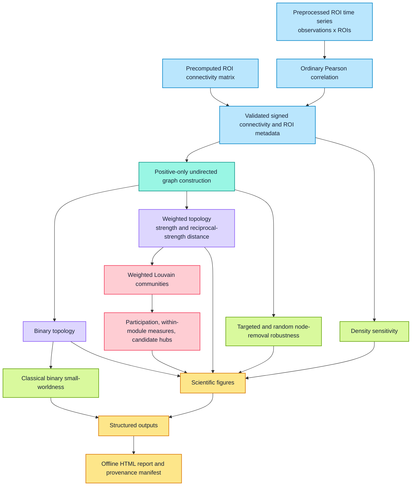

# Brain Connectome Pipeline

**Functional Network Topology, Community Structure & Robustness Analysis**

[](https://doi.org/10.5281/zenodo.23423753) [](https://github.com/ishavats28/brain-connectome-pipeline/releases/tag/v1.0.0) [](https://github.com/ishavats28/brain-connectome-pipeline/blob/main/pyproject.toml) [](https://github.com/ishavats28/brain-connectome-pipeline/blob/main/LICENSE)

## Overview and scope

Brain Connectome Pipeline is a reproducible Python workflow for graph-theoretic analysis of
functional brain connectomes. It accepts a validated ROI-to-ROI connectivity matrix or a table of
preprocessed ROI time series, constructs positive undirected binary and weighted graphs, and
quantifies topology, modular organization, candidate hubs, density sensitivity, classical binary
small-worldness, and mathematical node-removal robustness.

The software describes a constructed functional graph. It does not preprocess raw fMRI, make
diagnoses, infer causality, or establish clinical or anatomical significance.

## Features

- Strict CSV, TSV, and NPY matrix ingestion with explicit correlation, positive-weighted, or
  binary semantics.
- Ordinary sample Pearson correlation from finite, preprocessed observations-by-ROI tables.
- Deterministic positive-edge proportional thresholding with requested and achieved densities.
- Binary and positive-weighted global and nodal topology with explicit distance conventions.
- Seeded weighted Louvain communities, participation, within-module connectivity, and transparent
  rank-based candidate-hub characterization.
- Classical binary small-world sigma against connected, degree-preserving rewired null graphs.
- Independent density-threshold sensitivity and fixed-ranking targeted versus seeded random
  node-removal experiments.
- TSV and strict JSON results, deterministic PNG figures, provenance, a completion manifest, and
  a self-contained offline HTML report.

## Workflow



## Installation

Python `>=3.10,<3.14` is supported. With Windows PowerShell:

```powershell
py -3.12 -m venv .venv
.venv\Scripts\Activate.ps1
python -m pip install --upgrade pip
python -m pip install -e ".[dev]"
```

On macOS or Linux, create the environment with `python3 -m venv .venv`, activate it with
`source .venv/bin/activate`, then run the same `pip install -e ".[dev]"` command.

## Quick start

The bundled default configuration uses a small synthetic correlation matrix and does not represent
participant data.

```powershell
brain-connectome-pipeline validate-config --config configs/default.yaml
brain-connectome-pipeline inspect-input --config configs/default.yaml
brain-connectome-pipeline build-graph --config configs/default.yaml
brain-connectome-pipeline run --config configs/default.yaml --output-dir outputs/quickstart
```

Individual analysis commands remain available:

```powershell
brain-connectome-pipeline analyze-topology --config configs/default.yaml
brain-connectome-pipeline analyze-communities --config configs/default.yaml
brain-connectome-pipeline analyze-smallworld --config configs/synthetic_smallworld.yaml
brain-connectome-pipeline analyze-sensitivity --config configs/default.yaml
brain-connectome-pipeline analyze-robustness --config configs/default.yaml
```

All writing commands refuse collisions unless `--overwrite` is supplied. Add `--json` for a
machine-readable command summary. `python -m brain_connectome_pipeline` provides the same CLI.

## Input formats

Connectivity matrices may be CSV, TSV, or NumPy NPY. They must be square, finite, and symmetric
within the documented numerical tolerance. Table row and column identifiers must agree in exactly
the same order. External ROI metadata may contain stable identifiers, descriptive labels, and
optional coordinates; identifiers must be unique and dimensionally aligned. Missing labels are
replaced only by explicitly flagged deterministic placeholders such as `ROI_0001`.

Matrix semantics are declared, never inferred:

| Semantics | Validation and edge interpretation |
| --- | --- |
| `correlation` | Values in `[-1, 1]` within tolerance and an approximately unit diagonal; signs are preserved. |
| `positive_weighted_adjacency` | Nonnegative off-diagonal strengths; weights are not restricted to one. |
| `binary_adjacency` | Off-diagonal entries must be exactly zero or one; values are never silently binarized. |

CSV and TSV time-series tables use rows as observations and columns as ROIs. The pipeline requires
unique identifiers, finite numeric values, sufficient observations, and nonconstant regional
signals, then calculates ordinary sample Pearson correlations. It does not transpose ambiguous
input or apply Fisher-z transformation. Motion correction, nuisance regression, filtering,
scrubbing, temporal alignment, and atlas extraction must already have been handled upstream where
scientifically appropriate.

## Graph construction

Every ROI becomes a graph node, including isolates. Diagonal self-connections are excluded from
the graph without changing the stored source matrix. Strictly positive off-diagonal correlations
or adjacency weights are eligible; zero and negative correlations are absent from the primary
graph. Negative correlations remain preserved and counted in the ingested matrix and are never
converted to positive strengths with absolute values.

For proportional thresholding, density is retained undirected edges divided by `N(N-1)/2`.
Requested edge count is `floor(density * possible_edges + 0.5)`. Eligible edges are ordered by
descending original strength, with exact ties resolved by original ROI index. If too few positive
edges exist, achieved density is reported honestly below the request. Unthresholded mode retains
all eligible edges. Binary inputs preserve their existing topology by default rather than
arbitrarily subsampling equal-weight edges.

Binary and weighted graphs use the same selected edges. Weighted `weight` is the original positive
strength. For weighted paths only, `distance = 1 / weight`; NetworkX path algorithms interpret
distance as cost, not strength. Binary paths use unit hops. No disconnected graph is silently
reconnected, and unavailable whole-graph path measures remain unavailable.

## Global and nodal graph metrics

Global binary outputs include node and edge counts, density, components, isolates, largest-component
fraction, mean clustering, transitivity, global efficiency, characteristic path length when
connected, optional largest-component path length, and degree assortativity where defined. Full-
graph binary efficiency uses reciprocal hop distance over all ordered node pairs, with unreachable
pairs contributing zero.

Weighted outputs include mean NetworkX weighted clustering, mean node strength, total retained
strength, reciprocal-strength characteristic path length, and weighted efficiency. Weighted
efficiency uses reciprocal weighted shortest-path distance over all ordered node pairs, again with
unreachable pairs contributing zero; it is not NetworkX's unweighted `global_efficiency` relabelled
as weighted.

Per-ROI outputs contain degree, normalized degree centrality, positive strength, binary and
weighted clustering, binary and reciprocal-strength betweenness and closeness, binary local
efficiency, and weighted eigenvector centrality when mathematically suitable. NetworkX
Wasserman-Faust closeness normalization is used. Eigenvector centrality is unavailable for
disconnected graphs or solver failure. Undefined assortativity, path length, z-scores, and other
measures are represented by an explicit status and reason, never an unexplained NaN or zero.

## Community and hub analysis

Weighted Louvain detection optimizes modularity using retained positive `weight`, resolution `1.0`
by default, and an explicit seed. Stable community identifiers are assigned from original ROI
order, every ROI is retained, and isolates are not discarded. Louvain is heuristic: a partition is
not guaranteed to be globally optimal or stable under other seeds or resolutions, and detected
communities are not automatically known anatomical systems.

Binary participation is `1 - sum_c (k_i,c / k_i)^2`; weighted participation replaces counts with
positive strengths. Within-module degree and strength are reported along with population-standard-
deviation z-scores when a module has enough members and nonzero variance. Isolates and undefined
z-scores carry explicit unavailable reasons.

Candidate hubs are a graph-theoretic screening result, not an anatomical label. The configured
heuristic averages descending percentile ranks for normalized degree, strength, weighted
betweenness, and weighted participation. A node must have at least three eligible metrics and meet
the configured combined-score threshold (`0.80` by default). Average ranks preserve ties, and all
individual values and ranks remain in the output.

## Small-worldness

Classical binary small-worldness is
`sigma = (C / C_random) / (L / L_random)`, where `C` is mean binary clustering and `L` is binary
characteristic path length. Null graphs use seeded connected degree-preserving edge swaps, retain
the node and edge counts and degree sequence, and must be genuinely rewired. Reference means and
sample standard deviations use accepted nulls only.

The analysis requires a suitable connected observed graph and a sufficient valid null ensemble.
Disconnected, complete, tree-like, or otherwise nonrewirable cases are reported unavailable rather
than forced. Sigma depends on graph size, density, degree distribution, and null settings; a value
above one does not by itself prove biological small-world organization. This release does not label
sigma as a weighted coefficient.

## Density sensitivity

Each configured density is reconstructed independently from the same original eligible positive-
edge pool, preserving ROI order and deterministic tie handling. Outputs compare binary and weighted
efficiency, clustering, path availability, largest-component fraction, component count, and mean
strength. Repeated retained edge sets are identified explicitly. Density points are methodological
variants of one input, not independent biological observations, and a larger metric does not make
a threshold scientifically optimal.

## Network robustness

The primary targeted experiment ranks nodes once on the intact graph by positive strength (or the
configured degree criterion), then removes nodes cumulatively without recalculating ranks. Random
trials use distinct deterministic seeds and one nested permutation per trial at the same integer
checkpoints. The default fractions are `0.00` through `0.30`, converted using half-up rounding.

Largest-component size and retained-node count are normalized by the original node count.
Survivor-normalized global efficiency is reported separately from fixed-original-node efficiency;
the latter retains the original ordered-pair denominator and treats removed or unreachable pairs
as zero. Random means and sample standard deviations describe the configured trials without
inferential p-values. These are mathematical graph perturbations, not biological lesion models.

## Output structure

`run` writes one input-scoped directory and creates the completion manifest only after all required
stages and the offline report succeed:

```text
results/<input-stem>/
├── graph/                 # adjacency matrices, edge list, nodes, diagnostics
├── topology/              # global/nodal TSV and JSON
├── communities/           # assignments, participation, hub tables and summaries
├── smallworld/            # accepted-null table and summary when enabled
├── sensitivity/           # metrics, summary, and density plots when enabled
├── robustness/            # trial/audit tables, summary, ranking, and plots when enabled
├── figures/               # matrix, adjacency, abstract community, and hub figures
├── effective_config.json
├── provenance.json
├── report.html
└── execution_manifest.json
```

Skipped optional stages are recorded with a status and reason; misleading empty tables are not
created. JSON is strict and contains no NaN or Infinity literals. Paths in provenance and the
manifest are relative or input filenames rather than personal absolute paths. The layout is a
pipeline convention, not a claim of BIDS Derivatives compliance.

## Real-data demonstration

The documented example uses one resting-state recording from **YaleNeuroConnect**, OpenNeuro
dataset `ds007286`, version `1.0.7`, released under CC0:

- DOI: <https://doi.org/10.18112/openneuro.ds007286.v1.0.7>
- Recording: `sub-vd0116`, `ses-01`, `task-rest`, `run-01`
- Parcellation: Shen268
- Input: 385 observations and 268 ROI columns

The supplied precomputed matrix was identified as Fisher-z transformed: it had diagonal `6.103`
and values outside the correlation range. It was not relabelled as a correlation matrix. Applying
`tanh` off-diagonal agreed with Pearson correlations from the matching ROI time series to a maximum
absolute difference of `1.99e-6`, consistent with text rounding. The demonstration therefore uses
the matching preprocessed ROI table to derive ordinary Pearson correlations.

The preparation helper checks the exact documented index and trailing-empty-field schema, retains
exactly 268 finite numeric ROI columns in their original order, refuses source overwrite, and does
not filter or regress the signals. See [the full preparation and retrieval notes](docs/real-data-demonstration.md).

The saved completion manifest and result tables report:

| Quantity | Recorded value |
| --- | ---: |
| Positive / negative off-diagonal correlations | 17,162 / 18,616 |
| Requested density | 0.15 |
| Retained positive edges | 5,367 |
| Achieved density | 0.1500083850410867 |
| Primary graph | Connected; 268 nodes, no isolates |
| Louvain communities | 5 |
| Weighted modularity | 0.436529536835665 |
| Candidate graph-theoretic hubs | 17 |
| Accepted small-world nulls | 3 |
| Classical binary sigma | 2.3087153170158583 |
| Density thresholds | 5 |
| Seeded random-removal trials | 20 |

This is one descriptive recording, not a participant-group result. The three-null ensemble is a
modest workflow demonstration, and its sigma does not establish biological small-world organization.

## Figures


*Signed Pearson connectivity derived from the supplied ROI signals; ROI order is preserved.*


*Deterministic abstract spring layout colored by weighted Louvain community. It is not an anatomical
brain map; the 600 strongest retained edges are shown for legibility while analysis used all 5,367.*


*Requested density versus binary and weighted global efficiency for five constructions of the same
connectome; the points are not independent observations.*


*Largest-component fraction relative to the original 268 nodes. The random band is the across-trial
sample standard deviation; removal is a graph perturbation, not a biological lesion.*

## Reproducibility

Download only the two YaleNeuroConnect derivative files listed in
[the demonstration notes](docs/real-data-demonstration.md); raw MRI and the full dataset are
unnecessary. Dataset citation and licensing information are provided below.

Prepare and run the example on Windows:

```powershell
.venv\Scripts\python.exe examples\prepare_yaleneuroconnect_timeseries.py `
  --input data\real_connectome\sub-vd0116_ses-01_task-rest_run-01_atlas-shen268_desc-bis_timeseries.tsv `
  --output data\real_connectome\sub-vd0116_ses-01_task-rest_run-01_atlas-shen268_cleaned.tsv

.venv\Scripts\brain-connectome-pipeline.exe run `
  --config configs\example_real_connectome.yaml
```

The recorded run used Python 3.12.7, NumPy 2.5.4, pandas 3.0.6, NetworkX 3.7,
Matplotlib 3.11.2, and PyYAML 6.0.3. Community, small-world, and robustness seeds were `1729`.
`configs/example_real_connectome.yaml`, `effective_config.json`, `provenance.json`, and the
manifest record the effective methods, versions, statuses, warnings, and output inventory.

## Scientific limitations

- The demonstration contains one connectome: there is no group comparison, clinical validation,
  diagnostic prediction, statistical significance test, or causal inference.
- Results depend on upstream processing, parcellation, correlation estimation, positive-edge
  policy, threshold density, and numerical conventions.
- Negative correlations are preserved in the input but excluded from primary graph algorithms;
  signed-network interpretations are outside scope.
- Louvain is heuristic, candidate-hub ranking is a transparent heuristic, and the demonstration's
  small-world reference ensemble contains only three accepted nulls.
- Node removal is a mathematical robustness experiment, not a model of biological lesions or
  neural compensation.
- The selected derivative supplies generic ROI identifiers but no anatomical names or coordinates;
  none are invented, and the community plot is an abstract layout.

## Citation

Vats, I. (2026). *Brain Connectome Pipeline: Functional Network Topology, Community Structure &
Robustness Analysis* (Version 1.0.0) [Computer software]. Zenodo.
<https://doi.org/10.5281/zenodo.23423753>

Machine-readable citation metadata is available in [CITATION.cff](CITATION.cff). The source is in
the [GitHub repository](https://github.com/ishavats28/brain-connectome-pipeline), with the archived
code corresponding to the [v1.0.0 release](https://github.com/ishavats28/brain-connectome-pipeline/releases/tag/v1.0.0).

Analyses using the YaleNeuroConnect demonstration data should also cite the source dataset:
Samardzija et al. (2026), *YaleNeuroConnect*, OpenNeuro `ds007286` version `1.0.7`,
<https://doi.org/10.18112/openneuro.ds007286.v1.0.7>.

## License

Brain Connectome Pipeline is licensed under the [MIT License](LICENSE). The YaleNeuroConnect
source dataset is separate from the software and is released under CC0, not the MIT License.

## Potential extensions

The structured outputs can support carefully designed group-level studies, alternative validated
parcellations, or other explicitly justified graph-construction choices. Such extensions require
their own preprocessing, statistical design, validation, and interpretation.
