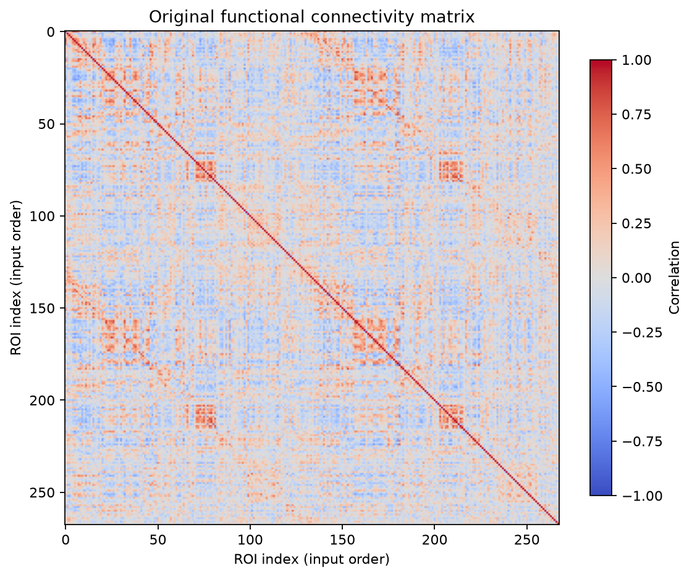
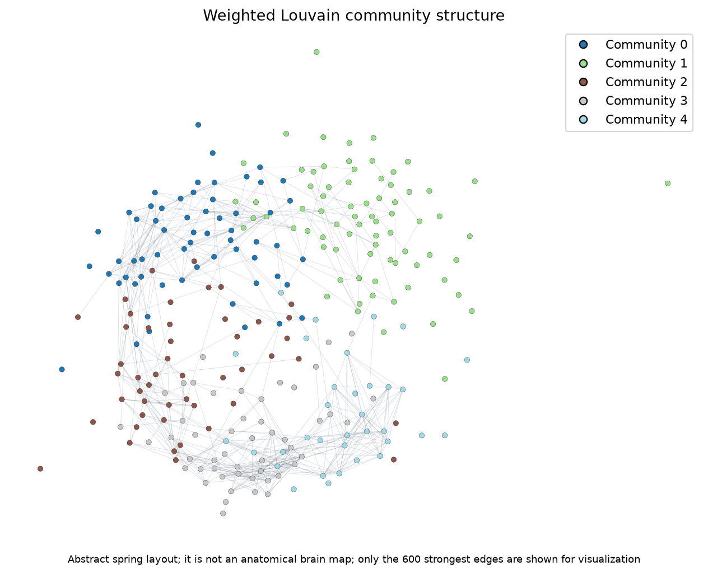
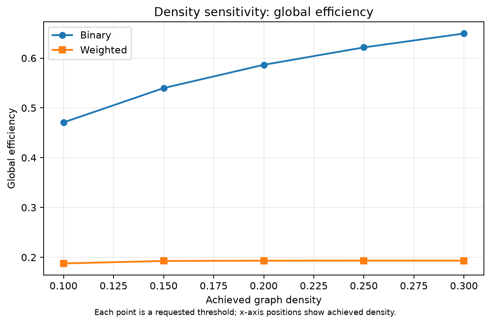
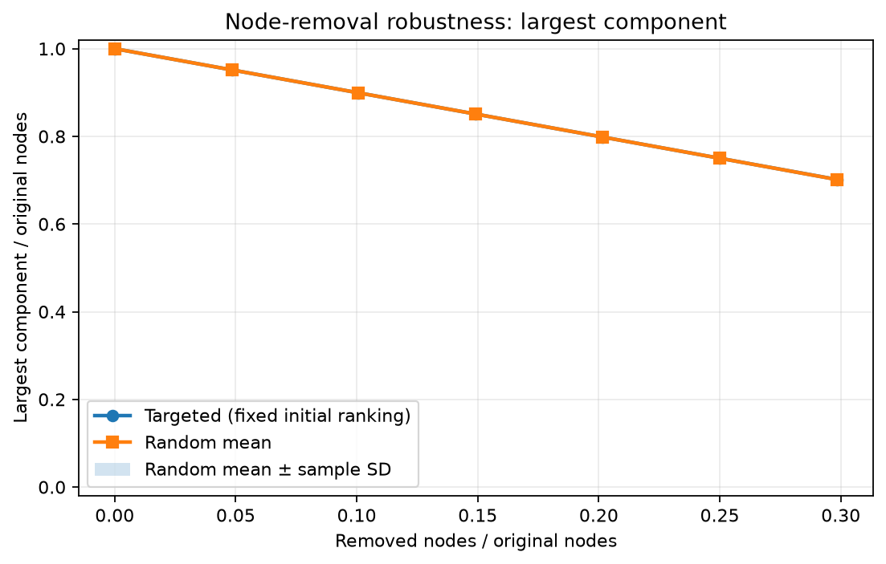

# Real-data demonstration: YaleNeuroConnect Shen268

This demonstration uses one resting-state derivative from **YaleNeuroConnect**, OpenNeuro
dataset `ds007286`, version `1.0.7` (CC0):

- Dataset page: <https://openneuro.org/datasets/ds007286/versions/1.0.7>
- Version DOI: <https://doi.org/10.18112/openneuro.ds007286.v1.0.7>
- Participant/run: `sub-vd0116`, `ses-01`, `task-rest`, `run-01`
- Parcellation: Shen268

No raw MRI, phenotype, diagnostic, or full-dataset files were downloaded. The official versioned
file listing was inspected first. The two relevant files are:

```text
derivatives/MC_Shen268/sub-vd0116/ses-01/func/
  sub-vd0116_ses-01_task-rest_run-01_atlas-shen268_desc-bis_matrix.tsv
  (704,778 bytes)

derivatives/roimean_Shen268/sub-vd0116/ses-01/func/
  sub-vd0116_ses-01_task-rest_run-01_atlas-shen268_desc-bis_timeseries.tsv
  (954,487 bytes)
```

Download only these individual files from the versioned OpenNeuro file tree. Store them under
`data/real_connectome/`; that directory is ignored by the repository.

## Matrix semantics and preparation

The supplied precomputed matrix is not an ordinary correlation matrix. Inspection found a
`268 x 268` symmetric finite matrix with diagonal `6.103` and some entries greater than one.
Applying `tanh` to its off-diagonal values reproduced Pearson correlations calculated from the
matching ROI table to a maximum absolute difference of `1.99e-6`, consistent with stored
Fisher-z values and text rounding. It is therefore intentionally not relabelled or ingested as
`matrix_semantics: correlation`.

The matching ROI table has 385 observations, a zero-based observation-index column headed `ROI `,
268 ROI signal columns (`ROI 0` through `ROI 267`), and an unnamed trailing empty field. The
preparation utility removes only those two non-ROI columns. It requires the documented index
header and sequence, requires the final field to be both unnamed and entirely empty, verifies
exactly 268 unique ROI identifiers, and rejects nonnumeric or nonfinite retained values. ROI order
is unchanged, and the utility refuses to overwrite the downloaded source. It does not alter,
filter, regress, or otherwise preprocess the ROI signals:

```text
.venv\Scripts\python examples\prepare_yaleneuroconnect_timeseries.py ^
  --input data\real_connectome\sub-vd0116_ses-01_task-rest_run-01_atlas-shen268_desc-bis_timeseries.tsv ^
  --output data\real_connectome\sub-vd0116_ses-01_task-rest_run-01_atlas-shen268_cleaned.tsv
```

The pipeline then derives an ordinary sample Pearson matrix using the documented
observations-by-ROIs convention. It performs no motion correction, nuisance regression, filtering,
scrubbing, temporal alignment, or atlas extraction.

## Reproducing the run

The exact effective settings are in `configs/example_real_connectome.yaml`: primary proportional
density `0.15`, weighted Louvain resolution `1.0`, density points `0.10` through `0.30`, 20 random
removal trials, and a deliberately modest three-sample small-world null ensemble.

```text
.venv\Scripts\brain-connectome-pipeline run ^
  --config configs\example_real_connectome.yaml
```

The local run completed in 109.6 seconds on the verification machine. Its manifest was written only
after all configured stages and the self-contained report succeeded.

## Observed graph results

These are descriptive results for this single constructed graph, not population, anatomical,
clinical, or causal findings.

| Quantity | Observed value |
| --- | ---: |
| ROIs / observations | 268 / 385 |
| Positive / negative off-diagonal correlations | 17,162 / 18,616 |
| Retained positive edges | 5,367 |
| Requested / achieved density | 0.150000 / 0.150008 |
| Connected components / isolates | 1 / 0 |
| Binary mean clustering | 0.457526 |
| Binary global efficiency | 0.539834 |
| Binary characteristic path length | 2.061462 hops |
| Weighted mean clustering | 0.183288 |
| Weighted reciprocal-strength efficiency | 0.192602 |
| Louvain communities / sizes | 5 / 61, 75, 48, 50, 34 |
| Weighted modularity | 0.436530 |
| Candidate graph hubs | 17 |
| Small-world nulls accepted | 3 of 3 requested |
| Classical binary gamma / lambda / sigma | 2.539296 / 1.099874 / 2.308715 |
| Density points / unique retained edge sets | 5 / 5 |
| Random-removal trials | 20 |

The three-network null ensemble is intentionally small and is suitable only as a lightweight
workflow demonstration. The observed sigma does not prove biological small-world organization.
Candidate hubs are input-specific ROI identifiers under the configured rank rule; the derivative
did not supply descriptive anatomical ROI names or coordinates, so none are invented here.

## Genuine run figures



The heatmap preserves the signed Pearson values calculated from the supplied ROI signals.



The community figure uses a deterministic abstract spring layout because no ROI coordinates were
supplied. It is not a physical brain map. Only the 600 strongest retained edges are drawn to reduce
visual clutter; analysis used all 5,367 retained edges.



Each point is a different graph construction from the same input, not an independent observation.



Largest-component size is normalized by the original 268-node population. Random uncertainty is
the across-trial sample standard deviation. Node removal is a mathematical graph perturbation, not
a biological lesion model.
